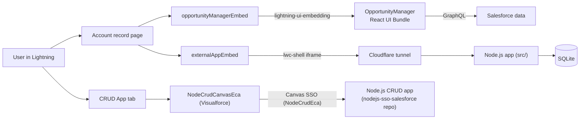

Canvas SDK, MFW (Multi-framework) and MFE (Micro-FrontEnd)

Salesforce DX project for the demonstration purpose: React UI Bundles running in Lightning Experience, a Node.js micro frontend (financial accounts) embedded in the Account record page, and a Node.js CRUD app opened from a tab with Canvas SSO.

> **Production org.** The deploy-gate hook blocks `sf project deploy start`: validate first and get explicit approval before deploying.

- **React UI Bundles** (`force-app/main/default/uiBundles/`): `AccountsApp` and `OpportunityManager`. Each is a Custom Application with its own `*_Access` permission set.
- **Opportunity Manager on the Account page:** `opportunityManagerEmbed` renders the `OpportunityManager` bundle through `lightning-ui-embedding`.
- **Financial accounts on the Account page:** `externalAppEmbed` embeds the Node.js app in `src/` (SQLite, served through a Cloudflare tunnel) in an iframe, using `lwc-shell` and passing the record id.
- **CRUD App (tab):** the **CRUD App** tab opens the Visualforce page `NodeCrudCanvasEca`, which renders the Canvas app `NodeCrudEca` (External Client App, Signed Request POST). The Node.js + PostgreSQL CRUD app signs the user in automatically (Canvas SSO). Its code, setup and security model live in [https://github.com/mgalvao2012/nodejs-sso-salesforce](https://github.com/mgalvao2012/nodejs-sso-salesforce); see [docs/architecture.md](docs/architecture.md#crud-app-canvas-sso).
- **Dev tunnel:** `npm run dev:tunnel` starts the tunnel and the app, writes the new URL into the metadata and deploys it.



Full component and sequence diagrams are in [docs/architecture.md](docs/architecture.md).

## Prerequisites

- Node.js 22.13 or newer (the `src/` app uses `node:sqlite`), Salesforce CLI 2 (`sf`), `jq`, `curl`, `lsof`, `cloudflared`
- Access to the **demo-org** with a user that can deploy metadata and assign permission sets

Details are in [docs/setup.md](docs/setup.md#prerequisites).

## Quick start

```bash
npm install
sf org login web --alias demo-org
sf config set target-org demo-org

# Node.js app for the financial accounts embed
(cd src && npm install && cp .env.example .env)   # then set SF_ORIGIN in src/.env

# Validate only (org is not changed), then deploy after approval
npm run dev:tunnel -- --validate-only
npm run dev:tunnel
```

Then open an Account record page in Lightning Experience (desktop). On **person** accounts (`Record.IsPersonAccount = true`) the **External app** panel loads the financial accounts table; on business accounts the Opportunity Manager panel is shown instead.

## Documentation

| Document | Contents |
|---|---|
| [docs/architecture.md](docs/architecture.md) | Components, sequence diagrams, embedding protocol, repository layout |
| [docs/setup.md](docs/setup.md) | Prerequisites and step-by-step setup (org, Node app, metadata, page activation, CRUD App pointer) |
| [docs/configuration.md](docs/configuration.md) | `src/.env` variables, npm scripts, metadata that carries the app URL |
| [docs/operations.md](docs/operations.md) | Dev tunnel, validate and deploy, UI Bundle build, page activation |
| [docs/security.md](docs/security.md) | CSP, iframe sandbox, origin checks, data exposure, residual risks |
| [docs/troubleshooting.md](docs/troubleshooting.md) | Blank embeds, tunnel and deploy errors, platform gotchas |

## Development

```bash
npm run lint          # ESLint for LWC and Aura
npm test              # LWC Jest
npm run prettier      # format metadata and sources
```

Each UI Bundle has its own `package.json` (`cd force-app/main/default/uiBundles/<name> && npm install && npm run dev`).

Tech stack: Salesforce API 67.0, LWC, React + Vite + TypeScript + Tailwind + shadcn/ui (UI Bundles), Express 4 + `node:sqlite` (`src/`), `@salesforce/experimental-mfe-lwc-shell` 2.2.4 (vendored as `vendorLwcShell`), Cloudflare quick tunnels.
