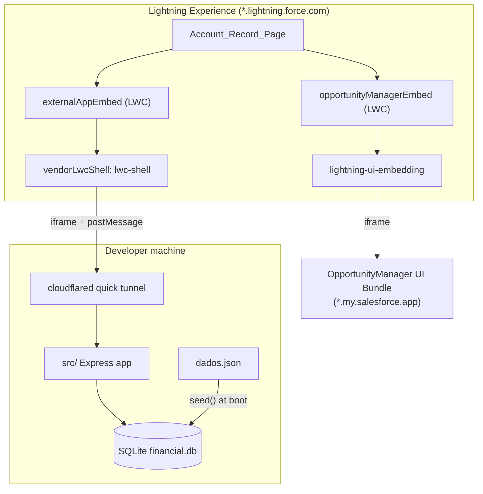
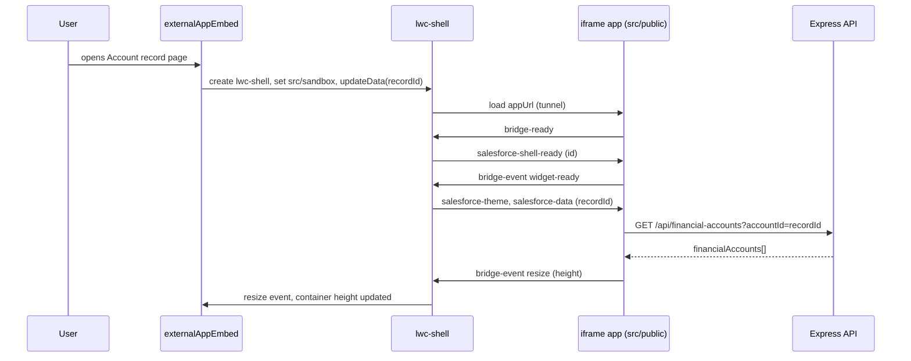
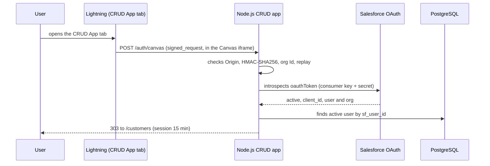

# Architecture

## Components



| Piece | Location | Role |
|---|---|---|
| `externalAppEmbed` | `force-app/main/default/lwc/externalAppEmbed` | Creates `<lwc-shell>`, pushes `recordId`/`objectApiName`, resizes the container, shows spinner/error |
| `vendorLwcShell` | `force-app/main/default/lwc/vendorLwcShell` | Vendored `@salesforce/experimental-mfe-lwc-shell` 2.2.4; registers `<lwc-shell>` (iframe, sandbox, bridge) |
| `opportunityManagerEmbed` | `force-app/main/default/lwc/opportunityManagerEmbed` | Embeds the `OpportunityManager` UI Bundle via `lightning-ui-embedding` |
| `Account_Record_Page` | `force-app/main/default/flexipages` | Record page; hosts `externalAppEmbed` (visible when `Record.IsPersonAccount` is true) and `opportunityManagerEmbed` (visible when it is false) |
| `FinancialAccounts` CSP Trusted Site | `force-app/main/default/cspTrustedSites` | Allows the tunnel origin as `frame-src` (and `style-src`) |
| `src/` | `src/` | Node.js app: `GET /api/financial-accounts?accountId=`, `GET /config.json`, static front end |
| UI Bundles | `force-app/main/default/uiBundles/*` | React apps exposed as Custom Applications |

## Financial accounts embed: sequence



## Embedding protocol

- The shell keeps the iframe `visibility: hidden` until it receives `bridge-ready` from the app.
- The app must echo the shell `id` (from `salesforce-shell-ready`) in every `bridge-event`.
- `src/public/app.js` accepts messages only from `window.parent` **and** from origins listed in `SF_ORIGIN`.
- The Express app sends `Content-Security-Policy: frame-ancestors 'self' <SF_ORIGIN>`, so only the Lightning origin can frame it.
- The shell sandbox is `allow-scripts allow-same-origin allow-pointer-lock` plus `allow-forms allow-modals` requested by `externalAppEmbed`. `allow-top-navigation` and `allow-popups` are blocked by the shell.
- Cross-origin iframes give no reliable load/error signal, so `externalAppEmbed` treats `widget-ready`/`bridge-ready` as the only success signal and fails after 5 s without it.

## Opportunity Manager embed

`opportunityManagerEmbed` builds the embedding URL for the `OpportunityManager` bundle and renders it with `lightning-ui-embedding` (iframe on `*.my.salesforce.app`). The bundle must post `sf-embedding/ready` (`public/sf-embedding-heartbeat.js`) or the iframe stays hidden. See [troubleshooting](troubleshooting.md).

## CRUD App: Canvas SSO

Customer/user CRUD (Node.js 22, Express 5, PostgreSQL). Source, full docs and the Salesforce metadata live in [mgalvao2012/nodejs-sso-salesforce](https://github.com/mgalvao2012/nodejs-sso-salesforce) (`docs/`, `salesforce/`). This repo only holds a partial copy of that metadata.



| Piece | Where | Notes |
|---|---|---|
| Tab **CRUD App** | org; in the CRUD repo `salesforce/.../tabs/NodeCrudCanvasEca.tab-meta.xml` | Visualforce tab, page `NodeCrudCanvasEca`. Not in this repo's `force-app` |
| `NodeCrudCanvasEca` | `pages/` (API 66.0) | `<apex:canvasApp developerName="NodeCrudEca" width="100%" height="800px" scrolling="auto"/>`, no header/sidebar |
| `NodeCrudEca` | `externalClientApps/` (header only) | External Client App, `distributionState` Local. Canvas, OAuth and policy settings are in the CRUD repo only: access method **Post** (Signed Request), location **Visualforce**, OAuth policy **AdminApprovedPreAuthorized** for the `NodeCrud_Access` permission set |
| `NodeCrud_Access` | org (1 assignment on 2026-11-18); CRUD repo `permissionsets/` | Grants the tab, the page and SSO. Not in this repo |
| Consumer key/secret | org; CRUD app `.env` | Never in git. Rotate with `npm run rotate-credentials` in the CRUD repo |

How it differs from the financial accounts embed:

- It uses **Canvas** (signed request + token introspection), not `lwc-shell`/`postMessage`.
- Its public URL (`canvasUrl` and OAuth `callbackUrl` of the ECA) is deployed by the CRUD repo's own `npm run dev:tunnel` or set to a fixed host with `npm run set-app-url`. It is independent of this repo's tunnel and CSP Trusted Site.
- Canvas sessions last 15 minutes and are tied to the Salesforce User Id. A Salesforce user only gets SSO if a local user is linked by `sf_user_id`.
- Deploying the CRUD repo's metadata overwrites the Canvas URL set by its tunnel script. Because this repo holds a partial copy of the ECA, **do not deploy `externalClientApps/NodeCrudEca` or `pages/NodeCrudCanvasEca` from here**; use the CRUD repo.

## Data model (`src/`)

`financial_accounts` (SQLite), reloaded from `dados.json` at every boot:

| Column | Notes |
|---|---|
| `financial_account_number` | Primary key |
| `account_id` | Salesforce Account Id (indexed); the ids in `dados.json` are org-specific |
| `category`, `product_name`, `modality`, `status`, `amount_type`, `main_conditions` | Display fields |
| `currency_iso_code`, `amount` | Formatted with `Intl.NumberFormat('pt-BR')` |

## Repository layout

```
force-app/main/default/
  applications/  AccountsApp, OpportunityManager
  cspTrustedSites/  FinancialAccounts, SciChart_Demo_Frame
  externalClientApps/  NodeCrudEca, React_Agentforce_Demo
  flexipages/  Account_Record_Page, LWC_Embedded
  lwc/  externalAppEmbed, vendorLwcShell, opportunityManagerEmbed, myEmbeddedApp2
  pages/  NodeCrudCanvasEca (Visualforce)
  permissionsets/  AccountsApp_Access, OpportunityManager_Access
  uiBundles/  AccountsApp, OpportunityManager
src/        Node.js app (server.js, db.js, tunnel.js, public/, dados.json)
scripts/    dev-tunnel.sh, set-tunnel-url.js
docs/       this documentation
```
